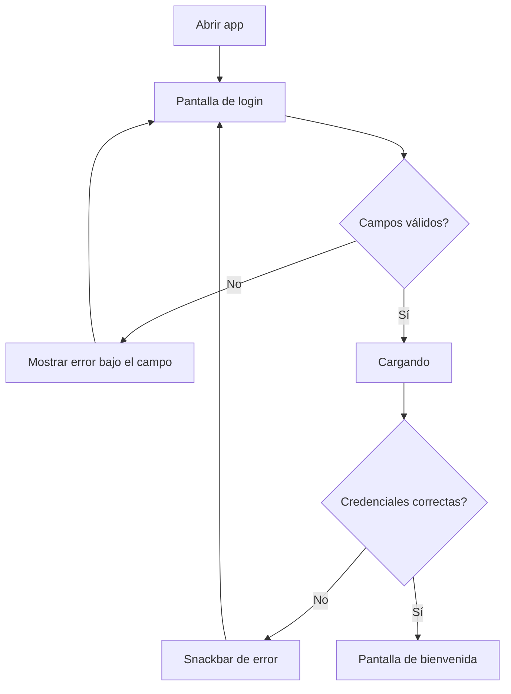

# Fase de investigación y arquitectura — Interfaz de Login

## 1. Problema y objetivo
Las pantallas de acceso son la primera interacción con una app. Si son lentas, confusas o dan errores vagos, el usuario abandona. **Objetivo:** una pantalla de login para Android que permita iniciar sesión en menos de 20 segundos, con errores claros, accesible y que se adapte al estilo del dispositivo (Material You).

## 2. Investigación
### 2.1 Usuarios (proto-personas)
| Persona | Contexto | Necesidad principal |
|---|---|---|
| Ana, 22, estudiante | Móvil, una mano, en trayecto | Entrar rápido, mostrar/ocultar contraseña |
| Luis, 45, profesional | Cambia entre móvil y tableta | Recordar sesión, recuperar contraseña fácil |
| Marta, 63, poca experiencia digital | Texto grande, pulso poco preciso | Botones grandes, mensajes en lenguaje simple |

### 2.2 Análisis de referentes (patrones comunes)
| Patrón | Observado en apps líderes (Google, bancos, redes sociales) | Decisión |
|---|---|---|
| Campos con etiqueta flotante | Estándar en Material | `OutlinedTextField` |
| Mostrar/ocultar contraseña | Casi universal | Icono en `trailingIcon` |
| Inicio social (Google) | Reduce fricción | Botón secundario (outlined) |
| Errores genéricos ("Error") | Frustran al usuario | Mensajes específicos bajo el campo |
| Teclado adecuado por campo | Ahorra tiempo | `KeyboardType.Email` + acciones IME |

### 2.3 Requisitos
**Funcionales:** validar correo y contraseña (≥ 8 caracteres); mostrar/ocultar contraseña; "Recordarme"; estado de carga; error de credenciales; enlaces a recuperar contraseña y registro.
**No funcionales:** Material 3; Material You (color dinámico en Android 12+) con paleta de respaldo; modo claro/oscuro; accesibilidad (contraste ≥ 4.5:1, áreas táctiles ≥ 48 dp, `contentDescription`); adaptable a tableta (ancho máx. 440 dp); minSdk 24.

### 2.4 Lineamientos Material 3 aplicados
Color por roles (`primary`, `surface`, `onSurface`, `outline`, `error`), formas redondeadas (botones pill, campos 4 dp), escala tipográfica M3, retícula de 8 dp, estados claros (foco, error, deshabilitado, carga).

## 3. Arquitectura
**Patrón:** MVVM + flujo de datos unidireccional (UDF), UI declarativa con Jetpack Compose.

```
UI (Compose)  ──eventos──▶  ViewModel  ──StateFlow<LoginUiState>──▶  UI
LoginScreen                LoginViewModel                      (sin lógica de negocio)
                                │
                                ▼  (futuro) Repositorio → API / Firebase Auth
```

| Capa | Archivo | Responsabilidad |
|---|---|---|
| Presentación | `LoginScreen.kt` | UI sin estado; recibe `LoginUiState` y callbacks |
| Estado | `LoginUiState.kt` | Datos inmutables de la pantalla |
| Lógica | `LoginViewModel.kt` | Validación, autenticación simulada, errores |
| Tema | `ui/theme/*` | Color, tipografía, Material You |
| Entrada | `MainActivity.kt` | Edge-to-edge y tema |

### Flujo de interacción


### Estrategia Material You
`dynamicLightColorScheme / dynamicDarkColorScheme` en API ≥ 31; en versiones anteriores se usa la paleta estática (semilla `#6750A4`) definida en `Color.kt`.

## 4. Entregables de diseño
1. Bocetos → `docs/sketches/01-bocetos-login.svg`
2. Wireframes → `docs/wireframes/02-wireframes-login.svg`
3. Mockups → `docs/mockups/03-mockups-login.svg`
4. Prototipo funcional → proyecto Android Studio (`app/`)

## 5. Pruebas sugeridas
Credenciales de demostración: `demo@correo.com` / `Demo1234`. Probar: campos vacíos, correo inválido, contraseña corta, credenciales incorrectas, rotación, modo oscuro, cambio de fondo de pantalla (Android 12+), TalkBack.
